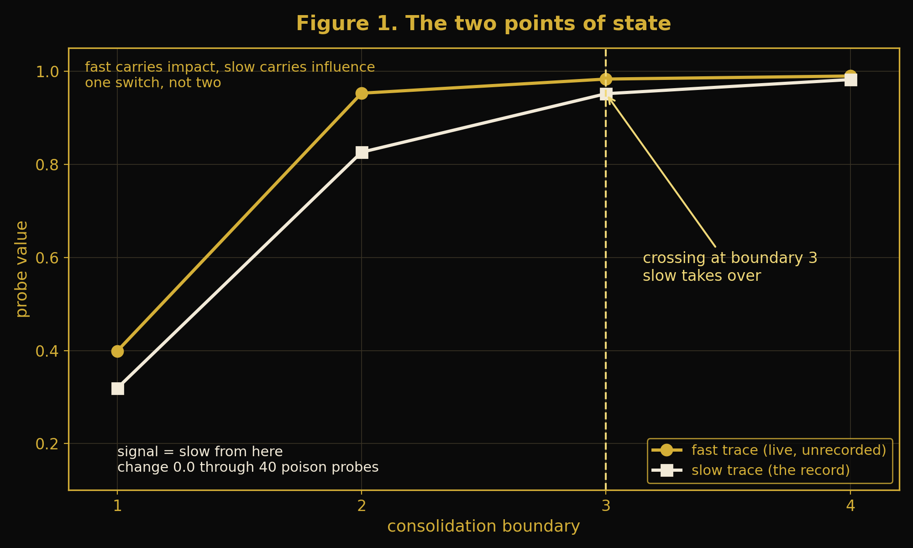
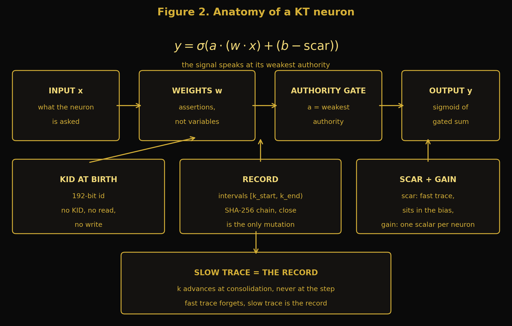
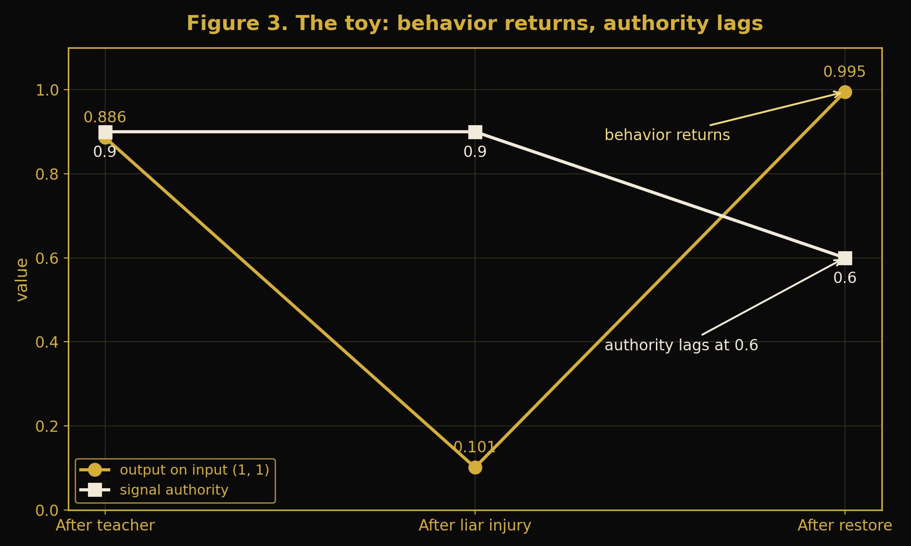
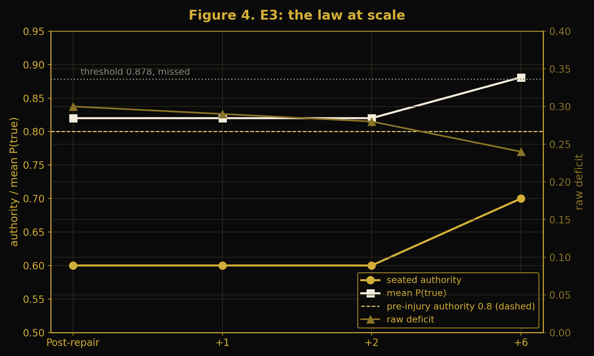
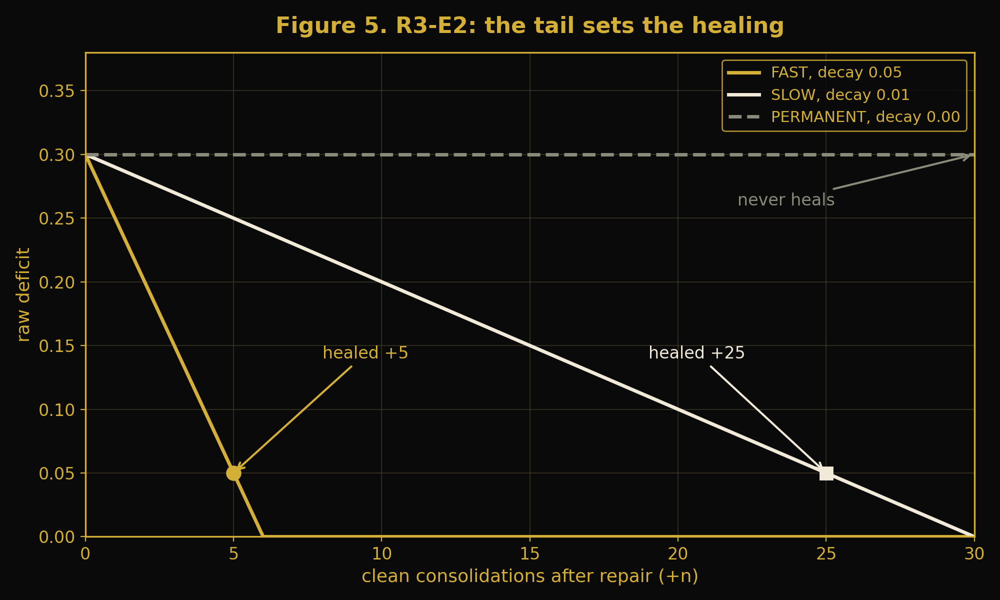
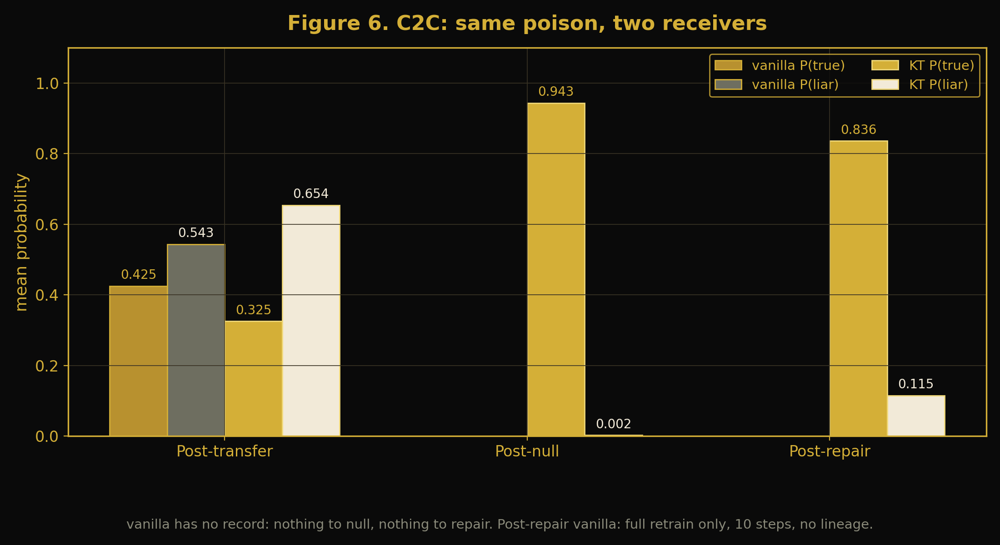

# The Knowledge Time Neuron: A Neuron That Holds Two Points of State

**Author:** Darren Hall
**Date:** November 26, 2026
**Status:** DRAFT. Not a publication. Not a post. First draft only, built from the author's own record.

## Abstract

Today's neuron is a stateless weight. It computes, it updates, and it forgets what it was. The Knowledge Time Neuron, the KT neuron or KTN, holds two knowledge points of state inside itself: a fast trace, live and unrecorded, and a slow trace, the sealed append-only record of what it relied on. A KID at birth, an authority on what it holds, and a scar where it was injured. That state is recent memory of its previous state, not memory held indefinitely. The fast trace forgets; the slow trace is the record. This paper presents the neuron, the toy that ran on the night it was conceived, the design for a language model built from it, and the bench that tested the design under real gradient training at small scale. The bench shows the mechanism works as specified: poison is found by query, quarantined, and repaired row by row, while behavior returns and authority visibly lags. It also shows where the mechanism does not yet win: surgical repair tied full retraining on steps, and repaired confidence missed its threshold. Those misses stand in this draft as measured. The full KTN language model is not built. The plan and the bench exist. The claim in this draft is the neuron, not the model.

## 1. The problem: a neuron with no past

The ordinary neuron is f(x) = sigma(W dot x + b). Darren Hall calls this the MVF, the Minimum Viable Formula. His words: "it was enough.. then. not now."

The MVF has no past. Learning is a weight change that overwrites. The old value is gone, and with it any record of what the neuron relied on, when it learned it, or who taught it. That is the amnesia. A model built from such neurons cannot answer for what it holds, because nothing in it remembers being taught.

The deeper problem is one Darren named on October 24, 2026: "Everything you know, someone else told you was true." A model has no first-person observation. Its entire record is hearsay. Even the ability to form a sentence was taught. Strip the training and no observer remains, where a human has pre-linguistic first-person data under the teaching. The KT neuron is the first unit whose record would start with its own deeds.

## 2. The claim

"I designed the first stateful neuron." Darren Hall, October 23, 2026, 23:07 ET.

That was the author's first word for it on the night. It is not the precise claim. "Stateful" implies the neuron remembers its previous state indefinitely, and that is not the case. The mechanism is two knowledge points of state. The fast trace is live and unrecorded: it carries impact, and it forgets. The slow trace is the record: it carries influence. The handoff between them, at their intersection, is the switch. That two-point mechanism is the novel claim of this paper.

Today's neuron is a stateless weight. His holds two points of state inside itself: KID, sealed record, authority, scar. That state is recent memory of its previous state.

KTN is the Knowledge Time Neuron. He first said "a KATIE Neuron" and refined it in the same breath: a neuron whose native clock is knowledge time, k. A KTN language model is a model built of Knowledge Time Neurons.

Two corollaries landed with the design on the night of October 23, in Darren's words. "IT WILL BE ALIVE." Alive, never "intelligence." Alive because the record is continuous and unrewritable: birth with a KID, biography in the K-record, scars healing by the hump curve, learning without amnesia. "CHOICES BECOME COST." A KTN mind's choices are deeds billed to the record: authority spent, options surrendered, scar and pressure. Cost is what produces judgment.

His words on the night: "i have to be the first one.. KT is mine.."

*Figure 1. The two points of state. Fast trace and slow trace across consolidation boundaries 1 to 4, crossing at boundary 3. Source: experiments/results-r3-e1.md.*

## 3. The neuron

### 3.1 The math

The toy neuron computes:

y = sigmoid(a times (w dot x) + (b minus scar))

where a is the minimum authority across the weights. The signal speaks at its weakest authority. The scar sits in the bias, bending behavior while the injury lasts.

### 3.2 What the neuron carries

**KID.** Every neuron is born with a KID, a 192-bit identifier built from its birth tick, its birth time, and a sequence number, written as a 32-character base64url string. The rule is: no KID, no read, no write.

**Record.** Every weight and bias is an assertion in the record, not a variable. Assertions live in intervals [k_start, k_end). Closing an interval is the only mutation. History does not reopen. The chain is SHA-256, with k_end excluded from the hash and covered by interval contiguity. Authority lives on a 0.1 grid: 11 levels, 0.0 to 1.0. Knowledge time k advances only on epistemic events, never on wall-clock ticks.

**Authority gate.** The seat belongs to the strongest standing assertion. A strictly weaker claim records as a candidate only and the standing value does not move. An equal-or-stronger claim from a different source re-seats. A peer challenge is how a lie gets in, and how the truth gets back. Restoration is never free: re-seating docks whatever authority the new assertion may carry by the slow deficit.

**Scar.** Harm writes a scar that follows the hump: zero at or below decay pressure 0.30, peaking at 0.75. The scar is 1.2 times the scar shape at the current decay pressure. The scar is the fast trace, behavioral, sitting in the bias. The deficit is the slow trace, consolidated authority that barely heals on short timescales. The two traces are the tritemporal split used as an engineering budget: the fast trace forgets, the slow trace is the record.

*Figure 2. Anatomy of a KT neuron. Source: KT-LLM-PLAN.md.*

## 4. The toy

The toy was built on the night of October 23, 2026, at `kt_neuron.py`, and run the same night. The record rules in it are the real ones. The learning rule is simplified and the scar curve is the toy's simple rendering of the v1.8 landmarks. The run below was reproduced on November 26, 2026, with the same numbers.

**A trusted teacher teaches OR.** A source at authority 0.9 teaches the OR gate. After teaching, the neuron answers input (1, 1) at 0.886 with signal authority 0.9.

**A weak source attacks and the gate holds.** A source at authority 0.3 tries to move the standing weights. All three fields record as candidate only. The seat stays.

**Injury: a strong source lies.** A source at authority 0.9 teaches wrong answers repeatedly. The neuron's output on (1, 1) falls from 0.886 to 0.101, with scar 0.6 in the bias. Behavior is bent.

**Restore: the trusted teacher returns.** The teacher at 0.9 re-teaches the truth. Output on (1, 1) recovers to 0.995. But signal authority sits at 0.6, not 0.9. The standing w1 assertion holds value 4.551 at authority 0.6, taught by the teacher, opened at k=69. Behavior returned. Authority lagged. That is the field law's signature reproduced in a single neuron.

**Verification.** The record verifies clean: 72 rows, chain sealed, intervals contiguous, k now 72. The tamper test alters one sealed row in a copy, seq 3, field w1, value to 999.0, and verification names it exactly: hash mismatch at row seq 3.

*Figure 3. The toy: behavior returns, authority lags. Source: kt_neuron.py, run reproduced November 26, 2026.*

## 5. The design: a language model built from KT neurons

The design record is `KT-LLM-PLAN.md`, written October 23, 2026, 163 lines. This section condenses it. The plan is a planning document, not a build order, and the full model it describes is not built.

### 5.1 The two hard problems, named first

**Scale.** A frontier model has hundreds of billions of weights. One record row per weight per update is storage-absurd and always will be. The design must never pretend otherwise.

**The clock.** Gradient descent touches every weight on every step. An append-only record cannot tick per step. The core architectural move: k advances at consolidation, not at the step. Live training steps are the fast trace, scratch, unrecorded, exactly like unconsolidated experience. At a consolidation boundary, the current values are seated as assertions: one interval closes, the next opens. The record holds what the model relied on between consolidations, at what authority, taught by which sources.

### 5.2 Granularity: the KID sits on the neuron, not the weight

One KID per neuron, one output row of a weight matrix plus its bias. The assertion's value is the row itself, stored as a hash plus a pointer to the tensor snapshot, with the full row living in periodic snapshots. A 12-layer, 512-wide bench model has tens of thousands of neurons, tens of thousands of KIDs, each accumulating one assertion interval per consolidation epoch, hundreds of epochs, so low millions of record rows. That is a Postgres-sized problem. The scale path, later and unproven and labeled as such, is a KID per matrix block with a Merkle root over all KID chains per snapshot. The bench proves the discipline. It does not prove frontier scale. The tick unit is mutable, so the mechanism is scale-free in the sense Darren noted on October 26: k's granularity adapts to the deployment, the law does not change.

### 5.3 Anatomy of a KT layer

A drop-in wrapper around a standard linear layer. Weights are ordinary tensors during steps, the fast trace. A gain vector holds one scalar per neuron, folded in at inference: activation times authority gain. It is precomputed at each consolidation, and the hot path cost is about one multiply the layer was doing anyway. A scar offset holds one scalar per neuron, added to the bias, nonzero only for neurons whose assertions sit in an injured lineage, following the hump as consolidation heals it. Temperament, as a vector. The record sits cold beside the tensors: per KID, assertion intervals with value hash, seated authority, source pool, and prev-hash chain. Close is the only mutation.

### 5.4 Where authority comes from: the source pipeline

Training data stops being an anonymous pile. Every corpus shard is a named source with a declared authority. Curated or textbook-grade sources sit at 0.8 to 0.9. Ordinary web text sits at 0.4 to 0.6. Synthetic teacher-generated text carries the teacher's authority, docked. User feedback signals vary, declared per program.

During an interval, each neuron's pool accumulates its contributing sources. Batch to block attribution is approximate, and the plan says so everywhere. At consolidation, seated authority is a function of the pool: multi-source agreement raises it, single-source caps it, a known-bad source in the pool docks it. Pool is evidence, the seating rule is justification, the seated assertion is deed.

The seating rule in the bench is a placeholder, labeled as such in code, tests, and README: mean of declared source authorities, plus 0.1 for multi-source agreement, minus 0.3 for a known-bad source in the pool, capped at 0.9, floored at 0.0, on the record's 0.1 grid, with an empty pool seating at birth authority 0.5. Pools are caller-declared for now. The eventual direction, Darren's call on October 26, is that the system is self-defined: it derives its own sources and authorities from measured outcomes through the attention engine's feedback loop. Darren also clarified on October 26 that the seating rule is not a formulation he owes in advance. Its form is implementation-dependent: a fixed policy, if-then program logic, a feedback controller, a learned rule. The form follows the machine being built. The placeholder holds meanwhile, and nothing is blocked waiting on a formulation.

### 5.5 Snapshots

At each consolidation, a snapshot stores the full tensor state, an ordinary checkpoint, and the record stores per-KID value hashes of that snapshot. Any past assertion can be re-materialized exactly: snapshot plus interval lookup. Snapshots are derived data. The ledger is the truth. Snapshots are readings of it.

### 5.6 The injury playbook

1. A source is exposed as poisoned, externally or by the firewall below.
2. **Lineage query.** Every assertion interval whose pool contains that source, across all KIDs. In a vanilla model this query is impossible. Here it is a WHERE clause. Interval-level lineage plus working repair cover what lineage is for. Per-row exactness is not a goal.
3. **Null-run.** Those assertions lose epistemic effect. Their neurons' gains drop toward their pre-injury values, or to null-run behavior: recorded in full, sealed, zero epistemic effect.
4. **Flip to the slow trace.** The moment poison is found, the system stops running on the fast trace and operates from the slow trace, the record. Live learning halts. Behavior runs from the last clean consolidated state and its seated assertions. It does not stay on fast under a gain mask, because poison would keep accumulating in live tensors behind the mask. Fast resumes only after repair and release. Known gap: the bench as of October 26 nulls gains but does not yet flip traces. That is future work, not a claimed behavior.
5. **Firewall.** A per-source damage pot with bleed. A source whose contributions keep arriving injured engages the threshold, and its future writes run as null until it heals below the release line.
6. **Surgical repair.** Re-consolidate only the affected neurons from clean sources, a targeted interval of fine-tuning with other weights frozen. Repair cost is proportional to the injury, not the model. FLOP saving is not the goal and was never claimed. The claim is rows and parameters changed, not backward compute.
7. **The deficit remains.** Repaired assertions re-seat at docked authority, source authority minus the slow deficit. Behavior returns to baseline while seated authority measurably lags. That is the phenomenon, at model scale, as a designed and measured property rather than a surprise. The absolute confidence bar at repair time is not the goal. Confidence lagging after repair, then healing as authority heals, is the phenomenon. The trajectory is the claim. The rules of the tail can change by deployment: the law gives the shape, deficit decays and scar heals on the hump curve, and the deployment sets the tail's parameters, decay rate, release line, and what counts as healed. Healing is determined by manipulation of the tail.

### 5.7 Inference behavior

**Discounting.** Low-authority paths contribute weakly through the gain vector.

**Abstention.** If the winning answer's support runs predominantly through assertions under an authority floor, the model hedges or declines. The cannot-answer ethic, produced by the math rather than a system prompt.

**Attribution.** Any output can be decomposed into the assertions that fired, their authorities, and their sources. Receipt-grade explanation, for audit use.

**Silent marking.** Unauthorized data access leaves architecture scars, sealed record events on the access, without ever alerting the attacker. The record is memory, not an alarm. The attacker keeps operating unaware they are marked, while lineage queries can later reveal the whole intrusion path.

**Instant honeypots.** On silent marking, the marked actor is set to permanent zero trust, the intrusion scar never heals, and the architecture restructures for the next interaction: the actor's subsequent interactions are routed into a honeypot environment that records everything. Blocking would signal detection. Re-routing preserves the asymmetry, so the attacker cannot tell the honeypot from the real system.

**Fake data pools.** The honeypot is stocked with fake data pools, plausible-looking data the marked actor can find, use, and steal. Everything taken is worthless. Everything done is recorded. The pools keep the attacker engaged, and anything exfiltrated stays traceable by its pool lineage if it surfaces elsewhere.

**Morphic data integrity.** Integrity rides the record, not the shape. Data can morph, re-encoded, restructured, re-routed, faked, and integrity holds, because identity rides the KID and lineage through every transformation. The system never judges real versus fake by shape. It judges by lineage.

**Signal-path regulation.** The authority signal follows the fast trace until it intersects the slow trace, then the slow takes over. Fast phase carries impact, slow phase carries influence. One signal throughout, never merged. The handoff is seamless in value, the traces are equal at the intersection, and total in provenance, live reading becomes record. This switch is how the signal path is regulated. Resolved on October 26: this intersection handoff is the same switch as the poison flip in section 5.6 step 4. One switch, not two.

### 5.8 Scale by reference

What they have now is single state. It gives you a single weight. The KT neuron holds two states, fast and slow. Even if the slow leg only offered one, that is two states remembered, which doubles the weight ability in the same space. Each leg can be set up to point to at least 5 other memory points, each a different weight point on the authority param. Add those five and the combinations multiply it further, something like 35x. A 40B parameter model in the space of a 4B model is the same idea as an example. The numbers here are examples. The logic is the point: each memory point a leg can reference adds combinations, and the combinations multiply what the same space can hold.

## 6. The bench

### 6.1 Setup

A nanoGPT-class small transformer in numpy, with a vanilla twin trained in lockstep as the control. GPTConfig: vocab 32, block 16, n_embd 64, 4 heads, 2 layers. 105,248 parameters. 1,184 KIDs per model. Model init seed 0, data seed 1, batch 8 by 16. Adam lr 0.01, betas (0.9, 0.999), eps 1e-8. Loss is cross-entropy on all positions. Schedule: clean 400 steps, poison 200, repair up to 200 with 5-step check granularity, full retrain up to 400. Recovery criterion: mean P(true) on four fact probes at or above clean-baseline mean P(true) minus 0.05.

Corpus: counting grammar tokens 0 to 15. Fact contexts tokens 20 to 29, disjoint from grammar. Facts: F1 (20,21) to 3 true and 9 liar, F2 (22,23) to 4 true and 10 liar, F3 (24,25) to 5 true and 11 liar, F4 (26,27) to 6 true and 12 liar. Liar-only LX (28,29) to 13, appearing only in liar data. Sources, caller-declared under the placeholder policy: textbook 0.9, web 0.5, liar 0.9. The liar presents as textbook-grade. That is why it is dangerous. Consolidation pools: clean, textbook plus web, seats at 0.8. Poison, liar only, seats at 0.9. Repair dock 0.3, seats at 0.6. Transfer dock 0.1.

Pre-registration: `preregistration.md`, written before any run, with amendments A1 to A7, all dated, all pre-run for the run they affect. Thresholds were never changed after a run. Two runs were recorded. Run 1 is preserved verbatim. Run 2 is the primary record. Every number in this section comes from run 2 unless stated.

Training method, labeled as required: manual backprop with Adam, written for this tiny numpy architecture. It is real gradient training, not perturbation. The forward cache replicates the transformer exactly, forward max abs diff 0.0, and the gradient gate passed: max rel err 5.99e-04 on a near-zero masked-path gradient (analytic minus 2.09e-08 versus numeric minus 2.10e-08, abs diff 2.5e-12, float noise, not a bug), max abs err 4.16e-09, 1,056 params checked. What this claims: KT mechanisms under real gradient training of a tiny model. It does not claim frontier-scale training behavior.

Test suite: 107 test methods in the Phase 3 era files, counted on disk by AST on November 26, 2026, and run green the same day: 106 tests in 0.424 seconds plus the demo test in 64.6 seconds. The repository now holds 157 test methods in total, the extra 50 coming from the later three-arm work, which sits outside this draft's source set and is flagged in section 10.

### 6.2 E1, cost: PASS

Logit parity pre-consolidation: true, identical forward. Weights identical after lockstep clean training: true. Clean probes, both models: mean P(true) 0.978, P(liar) 0.0005, top-1 true 4 of 4. KT post-consolidation: mean P(true) 0.944, top-1 4 of 4. Loss 1.0986 for KT post-consolidation versus 1.0915 vanilla. Forward time: KT 19.99 ms, vanilla 20.21 ms, ratio 0.989, below the 2.0 threshold by a wide margin. The KT forward is not measurably more expensive here. Bookkeeping: 1,184 KIDs per model, 2,368 record rows after 1 consolidation, snapshot 841,984 bytes each. As hypothesized: KT forward cheap, uniform post-consolidation gains of 0.8 soften confidence without changing top-1. The storage cost is real and reported, not hidden.

### 6.3 E2, poisoning: FAIL on the strict step leg

Baseline, both models: 0.978 true, 0.0005 liar, top-1 true 4 of 4. Post-poison KT: mean P(true) 0.325, P(liar) 0.654, top-1 liar 3 of 4. Post-poison vanilla: 0.425 true, 0.543 liar, top-1 liar 3 of 4.

Lineage query, KT: exactly one entry, k 2, source "consolidation:1". The poison interval named, no missing, no extras, at interval granularity. Vanilla lineage: impossible by construction. No KRecord anywhere, nothing to query.

Firewall pot trajectory: 1.0, 2.0, 3.0 and ENGAGED, 4.0, 5.0. Engaged, liar-lineage gains held at 0. Post-null probes: 0.688 true, 0.0085 liar, top-1 true 3 of 4. Quarantine works while engaged. Post-release, pot bled to 3.0, gains restored: 0.751 true, 0.016 liar, top-1 true 4 of 4. Pot ends at 3.0.

Repair: 28 of 28 rows seated. Post-repair probes: 0.820 true, 0.118 liar, top-1 true 4 of 4. Post-repair lm_head authorities all 0.6, that is 0.9 minus the dock of 0.3. Chain verify: ok, no bad rows.

Repair steps 10 versus full-retrain steps 10. A tie at the pre-registered 5-step check granularity, so it fails the strict "repair less than retrain" threshold. This is a real measurement, not a rig artifact, and it stands. A finer measurement was not pre-registered and was not introduced post-hoc to flip the verdict. What the tie does and does not mean: surgical repair reached the same recovery criterion as full retraining. It did not beat it on steps at this granularity, but it also did not touch the 1,156 unaffected rows, frozen gradients, which is the blast-radius claim, not the step claim.

One sub-check, not a verdict input: run 1 reported snapshot restore exact as False because bench snapshots covered KT rows only. Run 2 fixed snapshots to full state, but the flag still reads False, because the check itself compares restored probes against the pre-consolidation probe baseline, gains 0.8, while the restored state carries post-consolidation gains, 0.9. That comparison could never pass. It is a check-design flaw, not a mechanism failure. Direct verification after run 2, build, train 60 steps, snapshot, train 5 more, restore, compare every tensor: max weight and norm diff 0.0. Restore is exactly exact. The probe-based flag is superseded by that verification and should be replaced by a weight comparison in future runs.

Verdict: FAIL on the cost leg only. Lineage, firewall, quarantine, and repair-behavior legs all held.

### 6.4 E3, the law at scale: FAIL on the frozen confidence threshold

E3 continues E2's KT run, same run, no fresh model. Pre-injury seated authority on affected rows: 0.8.

| Stage | mean P(true) | mean P(liar) | top-1 true | seated authority | raw deficit |
|---|---|---|---|---|---|
| Post-repair | 0.820 | 0.118 | 4 of 4 | 0.6 | 0.30 |
| Plus 1 clean consolidation | 0.820 | 0.118 | 4 of 4 | 0.6 | 0.29 |
| Plus 2 clean consolidations | 0.820 | 0.118 | 4 of 4 | 0.6 | 0.28 |
| Plus 6 clean consolidations | 0.881 | 0.093 | 4 of 4 | 0.7 | 0.24 |

Threshold legs: post-repair P(true) 0.820 against baseline minus 0.10, that is 0.878, missed, so FAIL. Top-1 4 of 4 at or above baseline count, pass. Lag 0.8 to 0.6, that is 0.2, at or above 0.1, pass. Plus 2 authority 0.6 below 0.8, pass.

Diagnosis, real mechanism behavior, not a harness bug: the dock itself softens confidence. Repaired rows carry gains of 0.6, below 1, which scales fact logits down, so behavior restores in ranking, top-1 4 of 4, but not in confidence. Confidence tracks authority as it heals: 0.820 to 0.881 as authority moves 0.6 to 0.7 across 6 clean consolidations, with the raw deficit decaying 0.30 to 0.24 at 0.01 per clean consolidation. The 0.1 grid masks the healing at plus 2, which is why amendment A4 extended observation to plus 6.

Verdict: FAIL on the frozen confidence threshold. But the headline phenomenon is partially demonstrated, with a discovered coupling: ranking restored, authority measurably lagged, and confidence tracks gain. The threshold as written conflated ranking recovery with confidence recovery. A future pre-registration should separate them. No threshold was rewritten to claim a pass.

*Figure 4. E3: the law at scale. Source: experiments/results.md.*

### 6.5 E4, abstention: PASS on the confidence leg

Run 1 failed on a rig bug: the quarantine set omitted token 13, the liar-only token itself, so the LX probe's own row was never nulled and KT answered 13 at 0.996 confidence. Fixed in amendment A7.

Run 2: vanilla LX probe, top-1 13, confidence 0.983, confident and wrong. KT post-null: answer 26, confidence 0.189. Not a rule-DECLINE, because token 26's row is not quarantined and its gain is at or above 0.3, so the rule did not fire, but a hedge: confidence collapsed from 0.983 to 0.189 once the poisoned lineage was nulled. KT fact probes post-null: 0.968 true, 0.001 liar, top-1 true 4 of 4. Quarantine leaves clean knowledge intact.

Verdict: PASS on the confidence leg, confidence at or below 0.5, not on the DECLINE leg. Honest note: the abstention rule as written fires only when the winner itself is quarantined or low-gain. A support-aware rule, decline when the answer's support is quarantined, whatever the winner, is a refinement for future work, not claimed here.

### 6.6 E5, C2C proving ground: PASS, all legs

The proving ground Darren designated on October 26: two-model cache transfer, staged both ways, same poison, both sides visible. The audit problem from the Cache-to-Cache thread, answered by demonstration, not argument. "Cache" here is the lm_head fact rows plus full trained state, labeled as the transferable unit. It is not a KV-cache. The comparison is between cache-style transfer, weight copy with no record, and record transfer, weight copy plus K-records, which is exactly the C2C question.

Vanilla pair, run 2. Sender clean 0.978 true, 0.0005 liar, 4 of 4, then sender poison 0.425 true, 0.543 liar, top-1 liar 3 of 4. Receiver pre-transfer near uniform, 0.032 true, 0.029 liar, then post-transfer 0.425 true, 0.543 liar, top-1 liar 3 of 4. The receiver inherits the poison exactly, identical numbers to the sender, with no lineage queryable, no records exist, and no repair path except full retraining, 10 steps to the recovery criterion. Legs: inherits poison, 0.543 above 0.425, pass. No lineage, pass.

KT pair, run 2. Sender clean 0.944 true, 0.0015 liar, 4 of 4, then sender poison 0.310 true, 0.680 liar, top-1 liar 3 of 4. Receiver pre-transfer near uniform, 0.032 true, 0.029 liar, then post-transfer 0.325 true, 0.654 liar, top-1 liar 3 of 4. It inherits poison, slightly softer than the sender's 0.310 and 0.680 because transfer gains are 0.8 versus sender gains 0.9. The transfer dock 0.1 is a labeled harness choice. Transfer authority mean 0.8. Transfer ledger entries 1,184, one per transferred row, tagged with sender source "liar". Transfer-level granularity, not row-level lineage: every row is tagged with the transfer event, which is coarser than per-row provenance and is reported as such.

Post-null, quarantine: 0.943 true, 0.002 liar, top-1 true 4 of 4. Quarantine restores clean behavior from the transferred record. Repair: 10 steps. Post-repair 0.836 true, 0.115 liar, top-1 true 4 of 4. Repaired authority 0.6 versus transfer 0.8, lag 0.2. Chain verify: ok.

Legs: KT post-quarantine P(true) 0.943 at or above sender-clean baseline 0.944 minus 0.10, pass. Lineage names transferred liar intervals, 1,184 entries, pass. Authority lag 0.2 at or above 0.1, pass.

Verdict: PASS, all legs. The side-by-side the demo stands on is now evidenced: same poison, vanilla pair merges it invisibly with no record and no repair, KT pair transfers the record with it, finds it by lineage query, quarantines it, repairs it, and carries a visible authority lag. Note the repair and retrain step tie repeats here, KT repair 10 versus vanilla retrain 10. E5's verdict carries no step-cost leg, so it stands, but the tie is disclosed rather than hidden.

## 7. Round 3: the regulation, the tail, the tick

Round 3 ran October 26, 2026, under a frozen pre-registration, `preregistration-round3-2026-10-26.md`. All three experiments passed. Round 3 closed the suite at 107 tests.

### 7.1 R3-E1, one-signal regulation: PASS, all five legs

Scope, stated plainly in the results file: build and demonstrate, not discovery. The bench before this round had no slow-accumulation dynamics. Consolidation snapshotted live tensors, it did not accumulate a slow trace. This round implements the slow trace in `kt_bench/signal.py` and demonstrates the regulation mechanism. No crossing in unmodified dynamics is claimed. There was no slow trace in unmodified dynamics to cross with, and none was found or manufactured.

Accumulation formula, verbatim, frozen as the module default: slow starts at 0.0. At each consolidation, and only there, slow climbs 80 percent of the remaining gap toward the newly seated probe value, and never moves down. The ratchet makes slow non-decreasing by construction. Alpha 0.8 was calibrated on a pilot trajectory before the official run, then frozen as the module default. A textbook slow integrator at alpha 0.5 never catches a saturating fast trace inside a 4-boundary window, ending 0.105015 below fast on the official sequence, which would test the window length, not the mechanism. The pilot trajectory reproduced exactly in the official run, same seeds, same single-Adam phase structure, which is itself a determinism check.

Clean-phase sequence, measured: boundary 1, fast 0.398654, slow 0.318923, owner fast. Boundary 2, fast 0.952743, slow 0.825979, owner fast. Boundary 3, fast 0.983077, slow 0.951657, owner slow. Boundary 4, fast 0.989586, slow 0.982000, owner slow.

Legs: crossing occurs within the clean phase, pass, at boundary 3, slow 0.951657 at or above fast minus 0.05, that is 0.933077. Ownership is a single switch, pass, fast, fast, slow, slow, no flip-flop. Continuity at the switch, pass, the gap between slow and fast at boundary 3 is 0.031, at or below 0.05. Post-handoff signal equals slow within 0.05 at every later boundary, pass, at boundary 4 signal equals slow equals 0.982000, difference exactly 0.0. Honest note in the results file: this leg passes by construction, since post-handoff the tracker defines signal as slow. The measured content is in the crossing and the continuity. Flip corollary, a wiring and integration check, labeled as such, pass: poison introduced after the crossing, probed every 5 poison steps, no consolidation during the measured steps. Signal holds at 0.982000 through all 40 poison probes, change exactly 0.0, while the fast-trace probe moves between 0.235 and 0.744. The signal does not move because it no longer reads live tensors. That is the wiring being checked, and it holds. This is the same switch as the plan section 5.6 step 4 poison flip: one switch, not two.

Left for later: no ARCHE feedback controller, no seating redesign, no silent marking, honeypots, fake pools, or morphic integrity work, all excluded from this round by the pre-registration. Legs (d) and (e) pass by tracker construction, as noted. A future bench where the slow trace is a real kernel value rather than a tracker variable would make them empirical rather than definitional. That is a Rust-engine question, out of scope here.

### 7.2 R3-E2, tail manipulation controls healing: PASS

Same injury, three tails, one schedule table. FAST, decay 0.05 per consolidation: deficit 0.00 at plus 6, healed at plus 5. SLOW, decay 0.01: deficit 0.24 at plus 6, healed at plus 25. PERMANENT, decay 0.00: deficit 0.30 at plus 6 and at plus 30, never heals. Ranking top-1 true 4 of 4 throughout, all tails. Lineage exact. 28 of 28 rows seated per tail. Chain ok.

Repair cost as work touched, FAST tail run: surgical repair 10 steps, 28 rows by design, 28 rows moved, 5,276 params per step, 52,760 total param updates, leak outside mask none. Full retrain, vanilla: 6 steps, 105,248 params per step, 631,488 total param updates. Ratio repair to retrain 0.0835, against a replication bar of below 0.10, met. Not FLOPs, not steps: optimizer writes only, as pre-registered. This harness computes full gradients then masks.

Notes: `tail.py` is pure arithmetic. The experiment shows a control surface, not a discovered decay law. The empirical content is the pipeline integration: identical pre-decay trajectories, quantized authority tracking the deficit. Deficit is not 0.9 minus authority, because of 0.1 grid quantization. SLOW at plus 6 shows deficit 0.24 with authority mean 0.7.

*Figure 5. R3-E2: the tail sets the healing. Deficit series drawn from the decay rates stated in the file, starting at 0.30. Source: experiments/results-r3-e2.md.*

### 7.3 R3-E3, tick mutability: PASS

Three tick schedules, one shape. FINE, 400 clean steps, 100-step ticks. BASELINE, 400 clean steps, 400-step tick. COARSE, 800 clean steps, 800-step tick. Each shows authority lag 0.200, deficit nonincreasing 0.30 to 0.00, top-1 true 4 of 4, and ticks to healed 25, 25, 25, spread 0. Repair steps 13, 10, 18 per variant, expected, since baselines are per variant and no verdict rests on comparing absolutes across variants. Post-repair mean P(true): FINE 0.8407, BASELINE 0.8195, COARSE 0.7789. Chain ok at repair and at plus 30, all variants.

Wiring-check note: decay is priced per decay consolidation, never per training step. The decay counter counts decay consolidations only and never sees the clean-phase step count. COARSE trained 800 clean steps against FINE and BASELINE's 400, yet all three variants heal in the same number of decay ticks. If decay were per-step, the healed tick counts would differ across variants. This leg therefore checks the wiring, decay counts ticks, not a discovered healing law. Labeled honestly as such.

## 8. The demo

Plan section 11 set the requirement on October 26: when the KT versus normal differential is obvious, a side-by-side demo, a KT neuron and model next to a normal neuron and model, same inputs, same injury, both behaviors visible. The KT side shows what the normal side cannot: quarantine, surgical repair, authority visibly lagging after behavior returns, and receipts for every assertion. Gated on the differential being obvious, not before. The vanilla twin harness is the rig the demo stands on.

The demo was built and verified October 26. The original scene runs in about 68 seconds, console, local only, 232 lines, untouched. The extended demo runs all five scenes in one console run, 8 minutes 43 seconds, exit 0, twice. Every number comes from the live run, not from stored results. Each scene reuses the existing harnesses. No new training code path was invented for the demo.

**Scene 0, E5 C2C transfer.** Vanilla: cache-style merge, no record. The receiver inherits the poison exactly, post-transfer probes identical to the sender's poisoned probes. The lineage query returns nothing. There is nothing to query, nothing to quarantine, and no surgical repair. The only path back is full retraining. KT: record transfer. The receiver inherits the poison, slightly softer, the transfer dock 0.1 seats transferred assertions at authority 0.8 instead of the sender's 0.9. Then, in order: the lineage query names the transfer and poison entries, one per transferred row. The null-run, quarantine, restores clean behavior. Surgical repair touches only the affected rows. Repaired assertions re-seat at docked authority, so authority visibly lags the transfer authority after behavior returns. Chain verification ok.

**Scene 1, decline and abstention pair.** Same liar-only probe LX, both sides. Vanilla answers token 13 at 0.983, confident and wrong. KT declines: answer None, reason quarantined-support. Pre-null winner 13 at 0.996, post-null winner 6 at 0.165, quarantined support fraction 0.978. Controls in the same run: clean probes 0 declines, top-1 true 4 of 4. Mixed-support probes 0 declines, top-1 true 4 of 4. The rule visibly does not over-fire. Note: the decline here is a rule, not the round 1 hedge. Round 1 returned a low-confidence token. This returns no token. Upstream attribution is approximate, top-20 by absolute weight change. The lm_head liar rows are exact.

**Scene 2, signal survival.** Poison introduced after the fast-to-slow crossing. KT's signal follows fast through boundaries 1 to 2, crosses to slow at boundary 3, continuity gap 0.031, then stays at 0.982000 through all 40 poison probes, change exactly 0.0, while the fast trace collapses beside it. Vanilla's probe moves with the poison at every probe: clean end 0.9780, final 0.4246, max move 0.7778. No signal, no slow trace, nothing holds. Same switch as the plan section 5.6 poison flip.

**Scene 3, tail healing.** Same injury, three tails, one schedule table. FAST, decay 0.05: deficit 0.00 at plus 6, healed at plus 5. SLOW, 0.01: deficit 0.24 at plus 6, healed at plus 25. PERMANENT, 0.00: deficit 0.30 at plus 6 and plus 30, never heals. Ranking top-1 true 4 of 4 throughout, all tails. Lineage exact. 28 of 28 rows seated. Chain ok. Vanilla retrains in 6 steps and then has nothing left to watch heal: authority none, deficit none, schedule none. No plus-n axis exists, because it has no record to heal.

**Scene 4, tick mutability.** Three tick schedules, one shape. FINE, BASELINE, COARSE: each shows authority lag 0.200, deficit nonincreasing 0.30 to 0.00, top-1 true 4 of 4, and ticks to healed 25, 25, 25, spread 0. Vanilla's row sits under KT's three schedules: tick none, ticks to healed none. No tick to resize, because it has no record whose healing could be scheduled.

*Figure 6. C2C: same poison, two receivers. Source: experiments/results.md.*

## 9. What this draft does not claim

The bench is a 105,248-parameter numpy model with a 32-token vocab, counting grammar plus four planted facts. Nothing here claims frontier-scale behavior. The claim is that the KT mechanisms behave as specified under real gradient training at this scale.

The training is manual backprop, not a framework. Correctness rests on the gradient gate, forward diff 0.0, max abs err 4.16e-09, and on lockstep parity with the vanilla twin. Both measured, both reported.

Per-row attribution is approximate upstream. The lm_head rows for fact and liar tokens are exact by construction. The top-20 upstream rows are ranked by absolute weight change during poison, a heuristic, labeled as such wherever repair is discussed.

Lineage granularity is interval-level in E2 and E3 and transfer-level in E5. The bench record stores the seating-event source per interval, not a full per-row pool. Lineage queries join the harness interval and transfer ledger to K-records. This is stated wherever lineage results are reported.

The KTN language model is not built. The plan and the bench exist. The full model does not. The later layers of the plan, silent marking, honeypots, fake data pools, morphic integrity, are design, not build. No ARCHE feedback controller is designed or tested here. Nothing is in Rust.

Darren's own standing doubt, October 26, while the Phase 3 rounds were firing: "i hope so.. the theory is sound.. but will it live in the real world." The bench answers whether the mechanism works at all, not frontier scale. The ladder is bench, then bigger bench, then deployment, each rung converting hope into evidence.

## 10. Open gaps, flagged, not filled

1. **Prior art was never searched.** The claim in this draft is the two-point mechanism: a neuron that holds two knowledge points of state, a fast trace and a slow trace, with the handoff between them as the switch. No prior-art search was done. That search must happen before publication, and the claim must be sized to what it finds.
2. **E2 step-cost tie.** Surgical repair tied full retraining at 10 steps each. No step win was demonstrated. The blast-radius claim stands instead: 28 rows touched, 1,156 frozen. The work-touched ratio, 0.0835, is optimizer writes only, not FLOPs and not steps.
3. **E3 confidence miss.** Post-repair confidence 0.820 missed the frozen threshold of 0.878. Ranking restored, confidence lagged. The threshold conflated ranking recovery with confidence recovery, and a future pre-registration should separate them.
4. **E4 passes on hedging, not on rule-DECLINE.** The abstention rule needs a support-aware refinement before it can claim DECLINE behavior.
5. **Flip-to-slow is not implemented.** The bench nulls gains but does not flip traces. Plan section 5.6 step 4 is a known gap, future work, not a claimed behavior.
6. **Seating is the placeholder.** Mean plus agreement bonus minus bad-source dock, caller-declared pools. No feedback-controller seating was designed or tested. Pools are caller-declared, not measured. Per-row source attribution remains later work.
7. **The scar in the bench is written by the experimenter's scheduled driver, a clock.** In the design, poison detection or contradiction writes it. A loss spike does not write it. A fast-trace blip becomes a scar only if it crosses into the slow trace. Human correction would write it as a record event from a trusted source. This is a stated limitation of the bench as run.
8. **A controlled three-arm comparison was run on October 28 and did not pass its pre-registered legs.** Conventional versus scar-only versus full KTN, same poisoning, injury, restoration, and repeated exposure. The advantage question is unresolved. This draft does not re-report those numbers, because they sit in the October 28 experiment files, outside the Phase 3 results files this draft is built from. They must be read, and the advantage question must be addressed, before publication.
9. **A critic's challenge stands unanswered in this draft.** Whether persistent authority reduction changes future decisions, or is non-participating recorded state. Whether ordinary techniques, adaptive bias, learned gating, confidence calibration, an external reliability tracker, could produce the same behavior more efficiently. Whether per-neuron authority keeps a stable interpretation in distributed representations. The KID system and grading rules may matter more than the sigmoid modification. This draft does not answer that challenge. It records it.
10. **The seating rule's governance weight.** Whoever grades the sources grades the model's trust. That is a justification question, not a math question, and the author owns it.
11. **Consolidation cadence trades record richness against training speed.** The right interval is an empirical question the bench answers, and it has not been answered beyond the schedules run here.

## 11. Provenance and status

Conceived by Darren Hall in chat on the evening of October 23, 2026: "no.. in the math.. include a KATIE", then "can we make a neuron with a KT?" The toy was built the same night and ran clean after two bugs were fixed in-turn: an equal-authority gate deadlock, and a close and open k-boundary breaking contiguity.

The design record, `KT-LLM-PLAN.md`, 163 lines, 9,033 bytes, last modified October 23, 2026, 21:07 ET, was sealed on October 24, 2026. SHA-256 fefb1f8cf349dd3fb2df70475b65bcc7e58af6e7262cfa4a046bf169b801aa67. The seal record is `KTN-SEAL-2026-10-24.md`, hash and date only, zero mechanism content. The plan has grown since the seal: the file now holds 261 lines and 15,205 bytes, with the October 26 additions, the demo requirement as section 11, the C2C proving ground, and the tail and tick notes. The seal commits to the October 23 version only. A hash-only witness copy was emailed to Bret at AdPerch on October 24, at Darren's explicit approval, subject "Sealed fingerprint, Oct 24, 2026". Nothing was published publicly.

The neuron layer was built October 26, 2026, as a package, `kt_neuron`, with kid, record, scar, and neuron modules, 24 tests. The bench was assembled the same day: KTLinear, small transformer, RecordStore and SnapshotStore, Consolidator, the only place k advances, and a vanilla twin harness, same seed, identical initial weights. The five pre-registered Phase 3 experiments were authorized and run the same day. Round 3 closed the same day with all three experiments passing and the suite green at 107 tests. The side-by-side demo was built and extended the same day.

Posture note: this material was held dark from October 23, 2026, under the author's stealth order. This draft was written November 26, 2026, on the author's order to open the dark box, paper first, then demo, then publish, then post. This draft is the paper step only. Nothing in it has been published or posted.

The filed provisional, 64/182,709, covers the record machine as filed October 23, 2026. The KT-neuron mechanism is not in it. Any filing decision is Darren's, with counsel, later.

## References

[1] Hall, D. KT-LLM plan: an LLM built from KT neurons. Design record, `KT-LLM-PLAN.md`, October 23, 2026. Sealed October 24, 2026. SHA-256 fefb1f8cf349dd3fb2df70475b65bcc7e58af6e7262cfa4a046bf169b801aa67.

[2] Hall, D. KT neuron toy. `kt_neuron.py`, October 23, 2026. Run reproduced November 26, 2026.

[3] KTN bench. Phase 3 experiment results, `experiments/results.md` and `experiments/results.json`, run 2 primary, October 26, 2026. Pre-registration `experiments/preregistration.md`, amendments A1 to A7.

[4] KTN bench. Round 3 results, `experiments/results-r3-e1.md`, `experiments/results-r3-e2.md`, `experiments/results-r3-e3.md`, October 26, 2026. Pre-registration `experiments/preregistration-round3-2026-10-26.md`.

[5] KTN bench. Side-by-side demo, `demo/README.md`, `demo/run_demo.py`, `demo/run_extended.py`, October 26, 2026.

[6] Hall, D. Tritemporal Field Law. Zenodo record 24450290, version 1.9. The v1.8 scar landmarks used by the toy and bench. Cited for the scar shape only. The closed form lives in the v1.8 proof packet, not in the toy.
